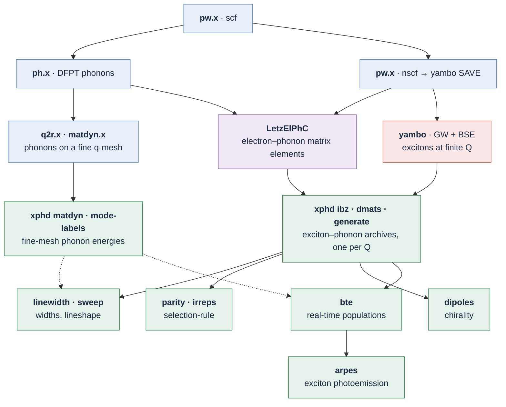
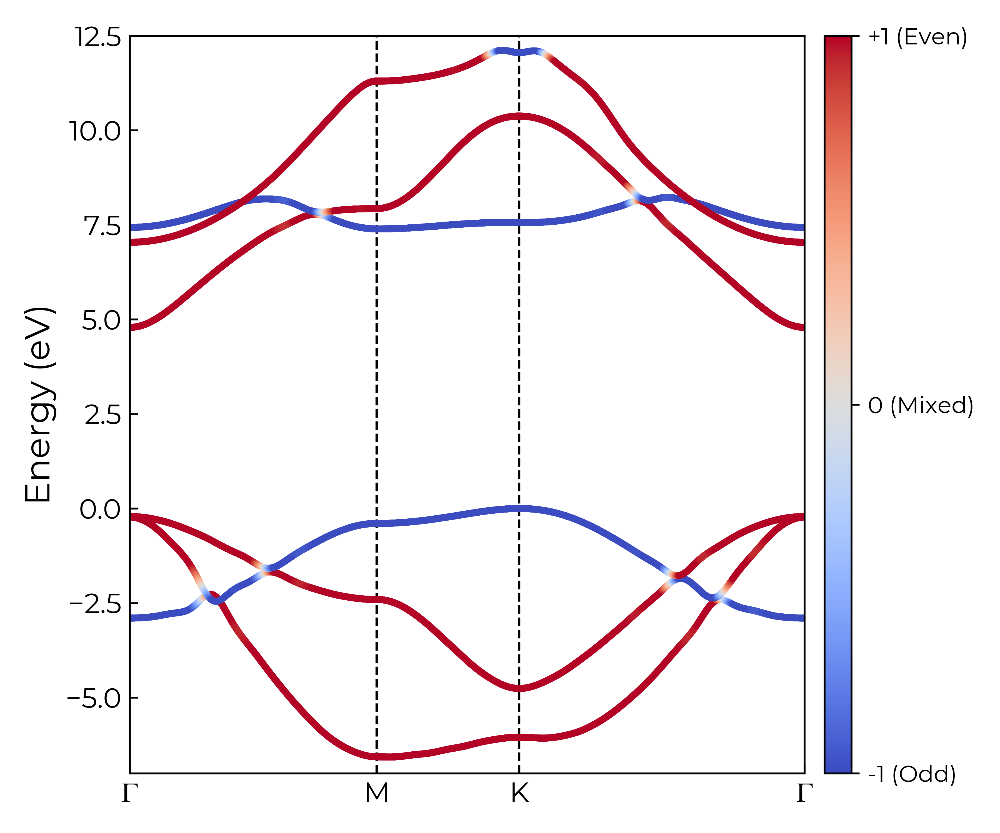
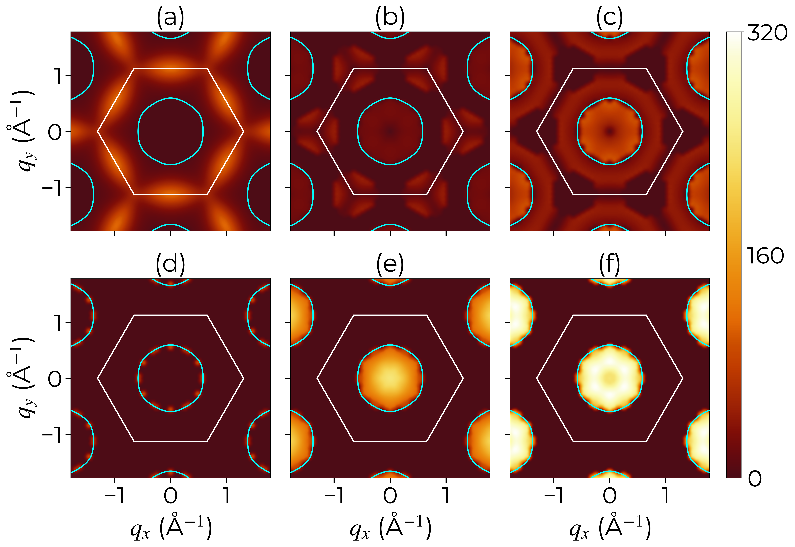
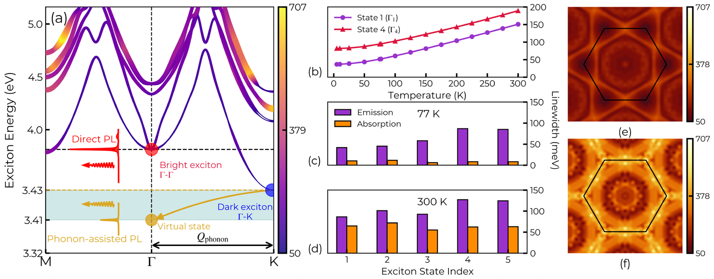
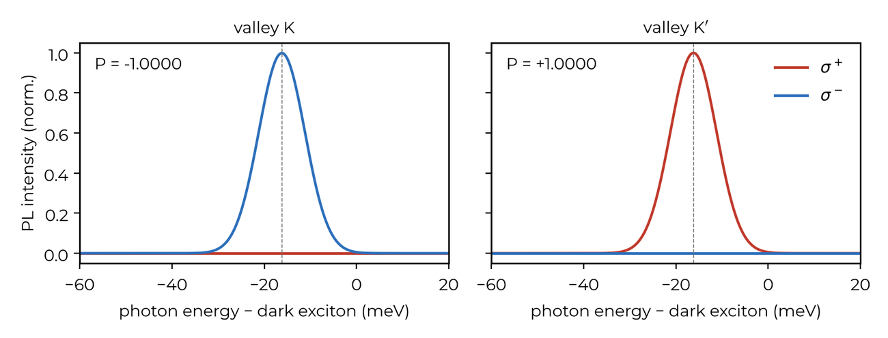
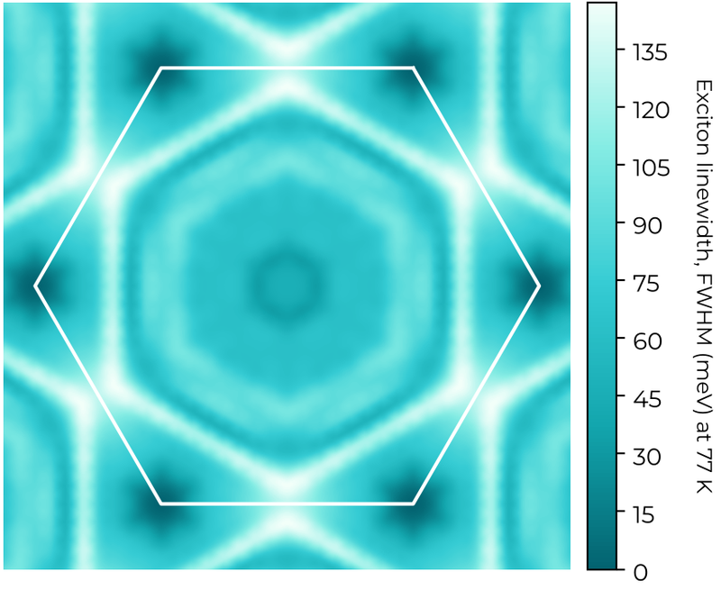
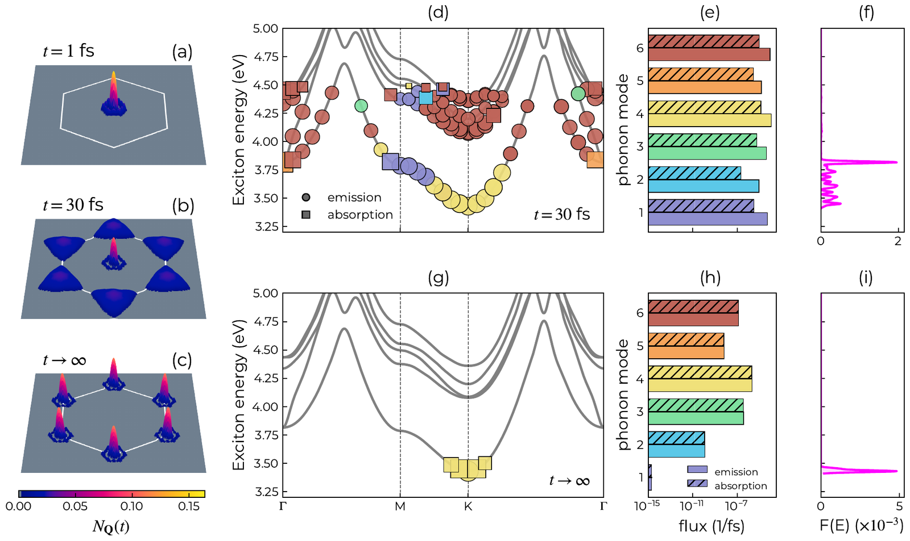

# xphd

```text
  __   _______  _     _____
  \ \ / /  __ \| |   |  __ \
   \ V /| |__) | |__ | |  | |
    > < |  ___/| '_ \| |  | |
   / . \| |    | | | | |__| |
  /_/ \_\_|    |_| |_|_____/

  Version 2.0.0  --  Exciton-Phonon Dynamics

  Developers:
    Rishabh Saraswat [1]            Mantasha Ansari [2]
    Rekha Verma [1]                 Sitangshu Bhattacharya [2]
    [1] Nanoscale Electro-thermal Laboratory, Indian Institute of
        Information Technology Allahabad, Uttar Pradesh 211015, India
    [2] Electronic Structure Theory Group, Department of Electronics and
        Communication Engineering, Indian Institute of Information
        Technology Allahabad, Uttar Pradesh 211015, India

  If you use xphd, please cite:
    - R. Saraswat, M. Ansari, R. Verma and S. Bhattacharya, Real-time
      relaxation dynamics of dark excitons in mirror-symmetric
      monolayers, arXiv:2610.12996 (2026)
    - xphd, GitHub, https://github.com/rishabhsrsw/xphd

  Acknowledgements:
    The developers thank the Anusandhan National Research Foundation
    (ANRF), India. This work was carried out under grant number
    CRG/2023/000476. This work used the computational resources of the
    PARAM Rudra 20 PF HPC system, provided by the Centre for Development
    of Advanced Computing (C-DAC) under the National Supercomputing
    Mission (NSM), India, jointly steered by MeitY and DST.
```

**Exciton–phonon physics in two-dimensional semiconductors, from first principles.**
From Quantum ESPRESSO, LetzElPhC and yambo databases, xphd builds exciton–phonon matrix
elements over the whole Brillouin zone and computes broadening-free exciton linewidths,
self-energies and absorption lineshapes, mirror-parity and symmetry selection rules,
exciton dipoles and chirality, real-time exciton relaxation and exciton photoemission
(ARPES), thermal and time-resolved. Shown here for monolayer GaN.

## Workflow



<table>
<tr>
<td width="44%"><br>
<sub><b>Mirror parity overlaid on the electron band dispersion.</b></sub></td>
<td width="56%"><br>
<sub><b>Coupling, branch by branch.</b> |G|² from the bright exciton; the polar branches (e, f) vanish wherever parity forbids them.</sub></td>
</tr>
</table>


<sub><b>Linewidths without broadening.</b> Exciton bands with their 300 K widths, the direct and phonon-assisted
luminescence channels, the width against temperature, emission and absorption, and maps over the zone.</sub>

<table>
<tr>
<td width="62%"><br>
<sub><b>A circularly polarised sideband.</b> The dark exciton emits 16.2 meV below itself, with P = ∓1 in the two valleys.</sub></td>
<td width="38%"><br>
<sub><b>Linewidth over the zone</b>, lowest band, 77 K.</sub></td>
</tr>
</table>


<sub><b>Real-time relaxation.</b> After injection into the bright state at Γ, the population moves into the K and K′
valleys within about 100 fs; every step is attributed to a phonon branch, by emission or absorption.</sub>

## Install

```bash
pip install -e ".[plot,yambo]"      # numpy, matplotlib, netCDF4
pip install -e ".[dev]"             # plus pytest
python -m pytest                    # synthetic data, no databases needed
xphd --help
```

The commands that read yambo databases also need [yambopy](https://github.com/yambo-code/yambopy),
installed from source. On a cluster, build `mpi4py` against the cluster's MPI and add the `hpc`
extra: `scripts/hpc/install_cluster.sh` does both.

## Start here

| | |
|---|---|
| [`docs/xphd_run.pdf`](docs/xphd_run.pdf) | what the upstream codes must produce, every command in order, parallel runs, troubleshooting and the option reference |
| `xphd --help`, `xphd <command> --help` | the options of every command |
| [`scripts/hpc/`](scripts/hpc) | SLURM and PBS job templates |

Every run writes a report next to its output: `<output>_report.pdf` on Windows and macOS (the
command, inputs with checksums, every parameter, the outputs, plots of the results and the log),
`<output>_report.txt` on Linux, to read with `less` on a cluster. `XPHD_REPORT=pdf`, `txt` or `both`
chooses; `--no-report` switches it off.

## Developers

- Rishabh Saraswat<sup>1</sup>, Mantasha Ansari<sup>2</sup>, Rekha Verma<sup>1</sup>, Sitangshu Bhattacharya<sup>2</sup>

<sup>1</sup> Nanoscale Electro-thermal Laboratory, Indian Institute of Information Technology Allahabad, Uttar Pradesh 211015, India<br>
<sup>2</sup> Electronic Structure Theory Group, Department of Electronics and Communication Engineering, Indian Institute of Information Technology Allahabad, Uttar Pradesh 211015, India

Developed by the Electronic Structure Theory Group, IIIT Allahabad.

## Citing

If you use xphd, please cite

- R. Saraswat, M. Ansari, R. Verma and S. Bhattacharya, Real-time relaxation dynamics of dark
  excitons in mirror-symmetric monolayers, [arXiv:2610.12996](https://arxiv.org/abs/2610.12996) (2026)
- xphd, GitHub, [github.com/rishabhsrsw/xphd](https://github.com/rishabhsrsw/xphd)

```bibtex
@misc{saraswat2026dark,
  author        = {Saraswat, Rishabh and Ansari, Mantasha and Verma, Rekha and Bhattacharya, Sitangshu},
  title         = {Real-time relaxation dynamics of dark excitons in mirror-symmetric monolayers},
  year          = {2026},
  eprint        = {2610.12996},
  archivePrefix = {arXiv}
}

@software{xphd,
  author  = {Saraswat, Rishabh and Ansari, Mantasha and Verma, Rekha and Bhattacharya, Sitangshu},
  title   = {xphd: exciton-phonon dynamics from first principles},
  version = {2.0.0},
  year    = {2026},
  url     = {https://github.com/rishabhsrsw/xphd}
}
```

`CITATION.cff` holds the same, for GitHub's *Cite this repository*.

## Acknowledgements

The developers thank the Anusandhan National Research Foundation (ANRF), India. This work was
carried out under grant number CRG/2023/000476. This work used the computational resources of the
PARAM Rudra 20 PF HPC system, provided by the Centre for Development of Advanced Computing (C-DAC)
under the National Supercomputing Mission (NSM), India, jointly steered by MeitY and DST.

## License

MIT, see `LICENSE`.
